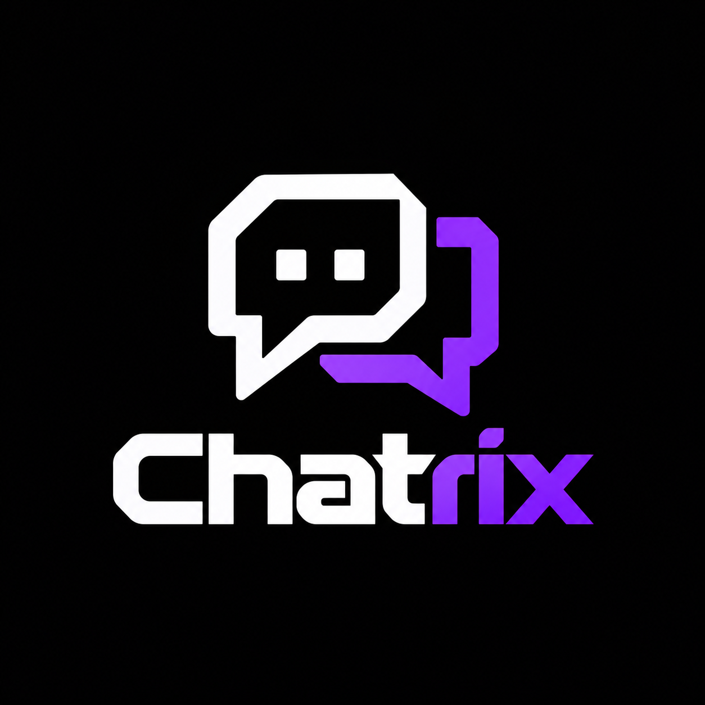
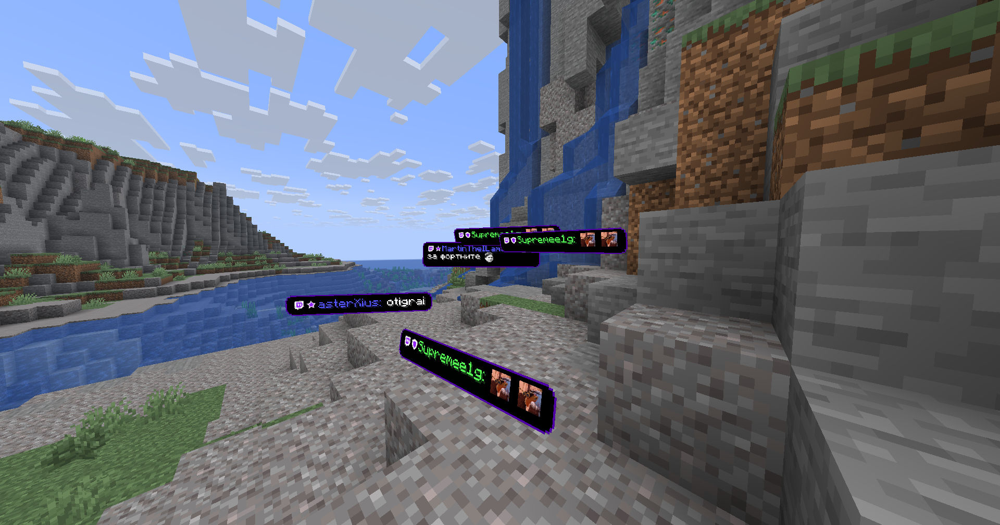
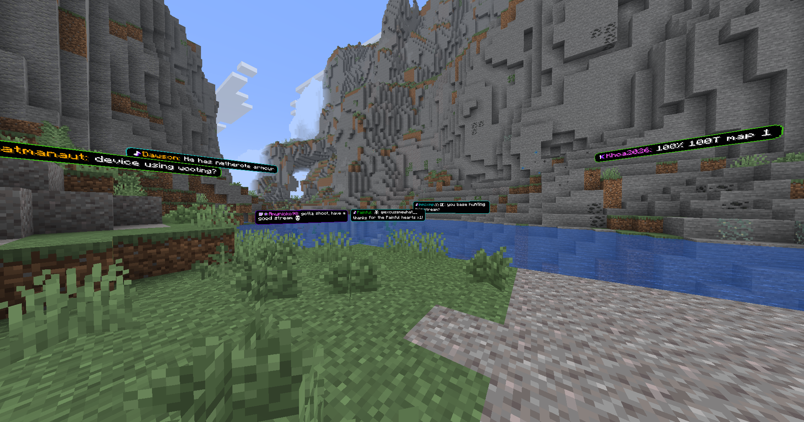
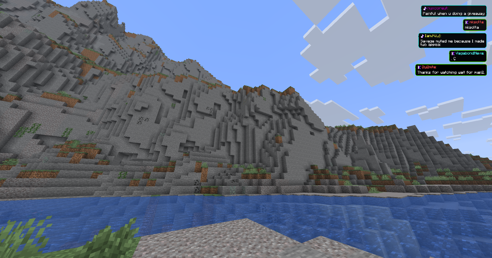
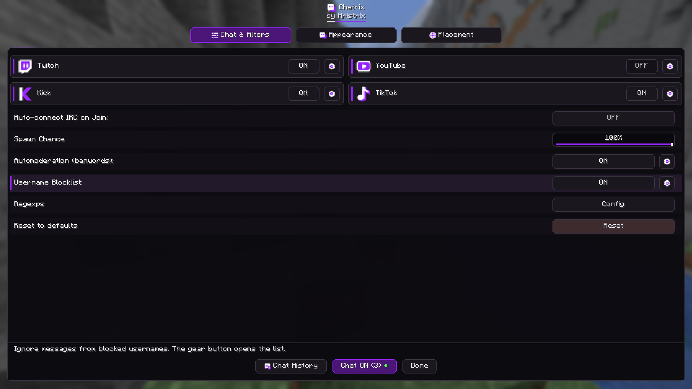
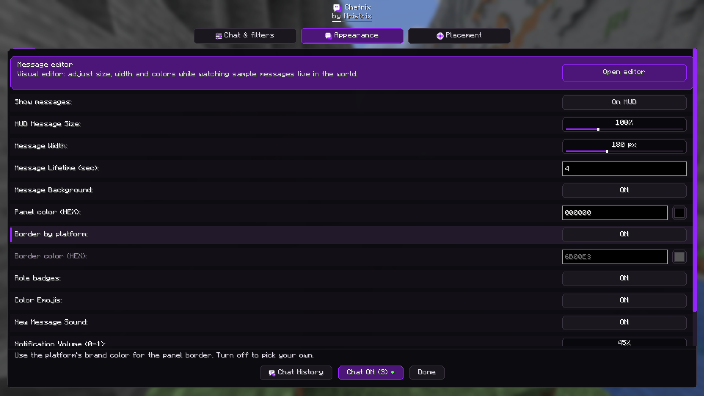
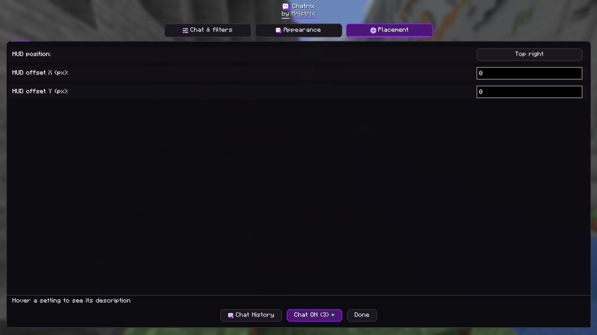
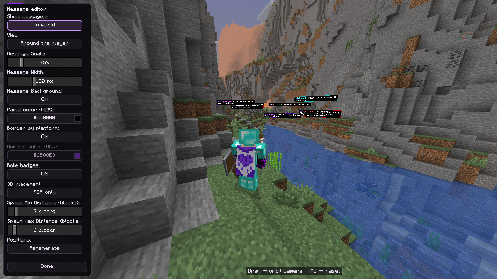
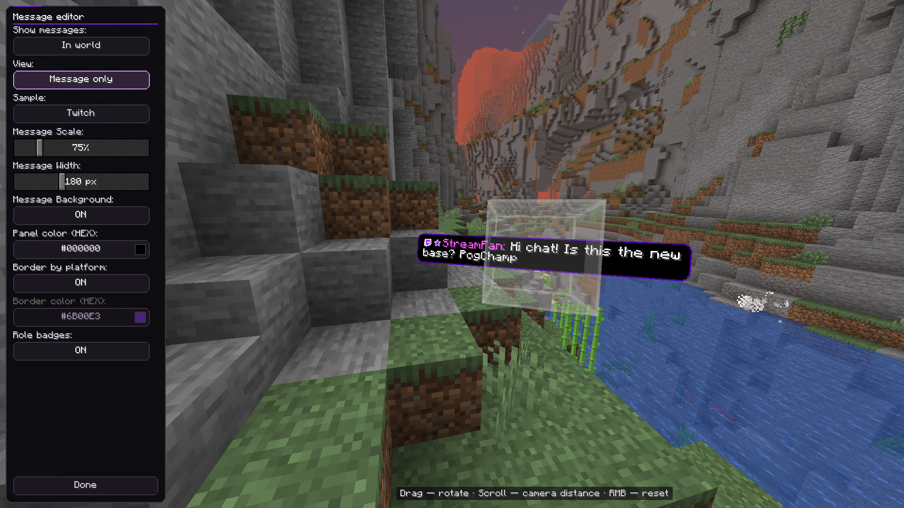
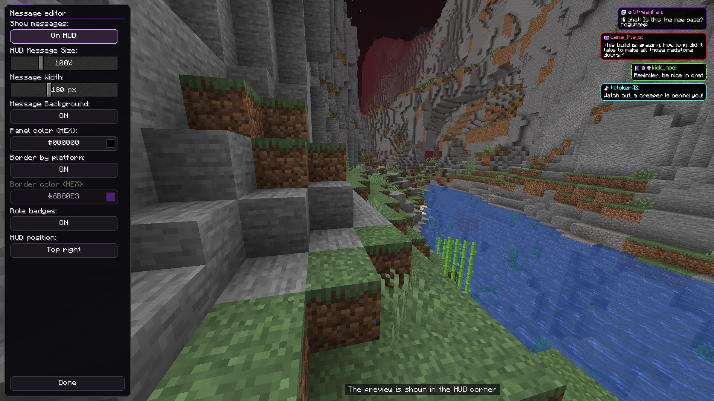

# Chatrix

Keep your stream chat close while you play. Chatrix brings messages from **Twitch, YouTube, Kick, and TikTok** into Minecraft, so you can follow the conversation without switching away from your game.

Let messages appear as little cards in your world, or keep them in a corner of your screen. Read a message, pin a favorite, and carry on with your adventure.

Made by **Hristrix** for Fabric. Chatrix runs on your client, so your server and friends don't need to install it.

## Before you start

You'll need **Fabric Loader** and **Fabric API**, along with the Chatrix jar that matches your Minecraft version:

**1.21.10 · 1.21.11 · 26.1 / 26.1.1 / 26.1.2 · 26.2 · 26.3**

Each version has its own jar; the `26.1` jar also covers `26.1.1` and `26.1.2`. Mod Menu is optional if you'd like another way to open settings. Chatrix currently supports Fabric only.

## Make chat feel at home

- **Bring everyone together.** Connect several streaming platforms at the same time.
- **Choose your view.** Show cards around you, keep them in front of the camera, or use a screen-corner overlay.
- **Take your time reading.** Look at a world message to pause its timer, or pin it to keep it around.
- **Keep the familiar faces.** See platform emotes, color emoji, and role badges alongside messages.
- **Catch up when you're ready.** Browse chat history and replay messages you missed.
- **Set the mood.** Adjust colors, size, placement, and sounds, with a visual editor to preview your changes.
- **Keep chat comfortable.** Use blocked words, username blocks, role filters, and regular expressions to choose what appears.
- **Include a little extra.** Turn on TikTok gift and follow events if you'd like to see them too.

## See Chatrix in action

From floating world cards to a tidy corner overlay, here's how chat can fit into your adventure. Click any screenshot to take a closer look.

**Chat becomes part of your world.** Twitch messages appear as floating cards, complete with colorful usernames, role badges, and emotes.

**Bring your communities together.** Messages from different platforms share the same world, while platform icons and colored borders help you see where each one came from.

**Keep chat within easy reach.** Prefer a familiar overlay? Stack messages in a screen corner so you can read along while exploring.

<strong>Explore the settings and visual editor</strong>

**Choose your chats and filters.** Enable Twitch, YouTube, Kick, or TikTok, open each platform's setup with its gear button, and manage blocked words, usernames, and regular expressions in one place. Press **`]`** to open settings.

**Make every message feel at home.** Adjust message size, width, lifetime, backgrounds, and borders. You can also choose whether to show badges and color emoji or play a sound when a message arrives.

**Find the right spot.** Pick a HUD corner and fine-tune its horizontal and vertical offsets to keep chat clear of the parts of your screen you use most.

**Preview chat around your character.** The visual editor lets you adjust world-card size, style, and spawn distances while seeing sample messages in the scene. Drag to orbit the preview camera and right-click to reset it.

**Get the details just right.** Switch to the message-only view to inspect a single sample card. Rotate it, zoom in, and try different platform samples while tuning its appearance.

**Try your overlay before going live.** Switch the editor to **On HUD** to preview sample messages in your chosen corner, then adjust their size, width, and colors to suit your layout.

## Let's get you connected

1. Install Fabric Loader and Fabric API for your Minecraft version.
2. Drop the matching `chatrix-2.2.0+<minecraft>.jar` into your `mods` folder. Choose the regular jar, rather than the one ending in `-sources.jar`.
3. Launch Minecraft, enter a world, and press **`]`** to open Chatrix settings.
4. Enter your channel or username in each platform's settings, then enable the platforms you want.
5. Press **`[`** to connect. Press it again whenever you want to disconnect.

Want to try the look before going live? Run **`/chatrix test Hello!`** to show a test message.

## Handy controls

| Key | What it does |
| --- | --- |
| `]` | Open settings |
| `[` | Connect or disconnect your enabled chats |
| `\` | Open message history |

With an empty hand, **left-click** an unpinned world card to dismiss it, or **right-click** to pin it. Hold right-click to drag a pinned card. You can adjust pin behavior in Chatrix settings and change the keys in Minecraft's **Options → Controls → Key Binds** menu.

## Prefer commands?

Most things are available in settings, but these are handy when you want a quick shortcut:

| Command | Action |
| --- | --- |
| `/chatrix help` | Show help |
| `/chatrix test <message>` | Display a test message |
| `/chatrix chat start` | Connect enabled platforms |
| `/chatrix chat stop` | Disconnect platforms |
| `/chatrix stop` | Clear messages and disconnect |
| `/chatrix banword add <word>` | Block a word |
| `/chatrix banword remove <word>` | Remove a blocked word |
| `/chatrix banword list` | List blocked words |
| `/chatrix blockuser add <username>` | Block a username |
| `/chatrix blockuser remove <username>` | Unblock a username |
| `/chatrix blockuser list` | List blocked usernames |

## Want to work on Chatrix?

Start with [BUILD.md](BUILD.md) to build your own jars, [DEVELOPING.md](DEVELOPING.md) for a tour of the code, or [RENDERING_GUIDE.md](RENDERING_GUIDE.md) for the message rendering details.

The Java package and Maven group are `com.hristrix.chatrix`; the mod ID and resource namespace are `chatrix`.

Comments and developer docs are in English. The interface includes English, Bulgarian, Russian, German, Spanish, French, and Simplified Chinese translations. The default blocked-word list is English, and you can customize it in game.

## License

Chatrix uses **CC0-1.0**. You can find the full terms in [LICENSE](LICENSE).
